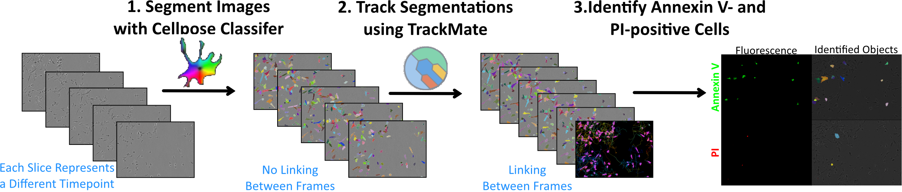
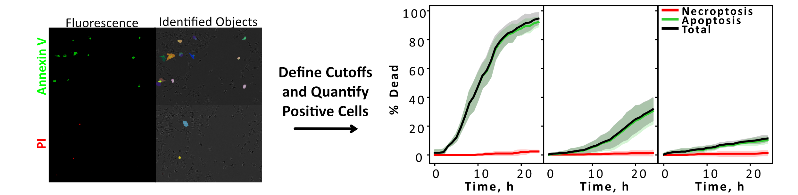
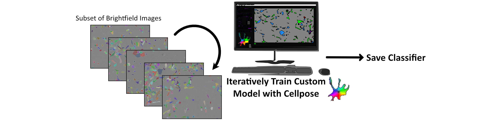

# FluoroFate

**A graphical user interface for time-resolved single-cell analysis of fluorescent reporter dynamics in multi-channel timelapse microscopy data.**

FluoroFate is a point-and-click desktop application that takes multi-channel timelapse or static TIFF images and performs automated cell segmentation and fluorescence thresholding — with cell tracking and temporal fate classification added for timelapses — all without requiring the user to write any code. The interface is built on [napari](https://napari.org/), providing interactive visualisation of every stage of the analysis so that results can be inspected and verified as you go.

The tool was developed to enable researchers without programming experience to perform rigorous, reproducible single-cell fluorescence quantification. It integrates established image analysis tools — [Cellpose](https://www.cellpose.org/) for segmentation and [TrackMate](https://imagej.net/plugins/trackmate/) for tracking — into a unified workflow with a consistent graphical interface, removing the need to move data between different software packages or write custom analysis scripts. Cells can alternatively be segmented directly from nuclear, cytoplasmic or membrane fluorescence channels, without Cellpose.

FluoroFate is generalisable to any combination of fluorescence channels and cell fate question. The work accompanying this tool used it to classify apoptotic and non-apoptotic cell death with Annexin V and propidium iodide (PI), and to follow FUCCI cell-cycle reporters combined with a caspase-3/7 activity reporter. The tool is equally applicable to any experiment in which fluorescent signals must be assigned to individual tracked cells over time.

---

## Overview of the Analysis Pipeline

The pipeline integrates cell segmentation, cell tracking, fluorescence thresholding, and temporal fate classification into a single analysis framework. The interface guides you through the analysis as a sequence of pages (upload → segmentation → channels and thresholds → tracking → analysis), with the result of each step shown in napari as you go; you can go **← Back** to change settings. Segmentation, tracking and analysis each save their outputs to disk as soon as they finish, and you can enter the pipeline at a later stage by uploading label images or linked tracks from a previous run (see [Using Existing Label Images](#using-existing-label-images)). Threshold previews are not saved, and FluoroFate does not keep a record of the Cellpose and TrackMate settings you used, so note them down.



### Stage 1: Cell Segmentation

Cells can be segmented in one of two ways, chosen on the page that asks **How would you like to segment your cells?**

**Cellpose (default).** Brightfield images (or any other channel you choose) are segmented frame-by-frame using Cellpose. A lower-bound cell area can be set to exclude debris or small artefacts. Either Cellpose's built-in model (Cellpose-SAM) or a user-supplied custom model can be used. The first time Cellpose runs, it downloads its built-in model (about 1.2 GB), which needs an internet connection. GPU acceleration (an NVIDIA graphics card via CUDA, or Apple Silicon) is used automatically when available; on Windows, an NVIDIA card is only used after you run the optional GPU commands in [Installation step 4](#4-create-the-fluorofate-environment). Segmentation outputs are saved as labelled mask stacks for downstream tracking.

Cellpose results are kept for the session: if you return to the Cellpose page without changing the images or the settings (including the **Save labels to** folder), the button changes to **Use existing segmentation →** and the previous labels are reused instead of re-running Cellpose. Only the most recent Cellpose run is kept, and it is forgotten when you click **Analyse Another Dataset** or restart the notebook.

**Fluorescence segmentation.** If you have a nuclear or cytoplasmic marker (optionally with a membrane marker alongside a nuclear one), cells can instead be segmented by thresholding those channels. Supported combinations are *Cyto only*, *Nuclear only*, *Nuclear + Cyto* and *Nuclear + Membrane*. With a nuclear channel, nuclei (objects smaller than 30 pixels are ignored) are used as seeds: with *Nuclear + Cyto* they are grown to fill the thresholded cytoplasm; with *Nuclear + Membrane* the image is divided between the nuclei along the membrane signal (so isolated cells also take in some surrounding background); and with *Nuclear only* each nucleus is expanded outwards by up to 50 pixels until it meets its neighbours. With *Cyto only*, the thresholded cytoplasm is split into individual cells directly. A **Preview (current frame)** button segments the frame currently in view so that settings can be checked before the whole stack is processed.

Whichever method you use, the channel(s) used for segmentation are reserved and cannot also be analysed as fluorescent reporters. Cellpose and fluorescence segmentation save files with the same names, so if you try both methods, give each its own **Save labels to** folder.

### Stage 2: Cell Tracking

Segmented objects are linked across time using TrackMate, which is run headlessly through PyImageJ — there is no need to open FIJI or interact with Java directly. Cell tracks are linked using the segmented cell masks and the Advanced Kalman Tracker. Configurable tracking parameters are **Initial search radius** (TrackMate's initial linking distance), **Search radius** (the Kalman search radius) and **Max frame gap** (the number of frames a cell can disappear before its track is closed); distances are in pixels. Optional track splitting (on by default) supports lineage-aware analyses: TrackMate follows cells through division, and FluoroFate then ends the mother's track at the division and follows each daughter as a new cell, recording mother–daughter relationships as hierarchical lineage identifiers (e.g. `3` → `3.1`, `3.2` → `3.1.1`, `3.1.2`). **Max splitting distance** sets how far a daughter's centre can be from her mother's for TrackMate to count it as a division. A relabelled stack with consistent cell identities across time is generated from the segmentation masks and TrackMate output. Cells that TrackMate does not link to any other frame, and cells whose centre lies outside their own outline (e.g. crescent-shaped cells), are left out of this stack and therefore out of the analysis.

> **Dividing cells:** because each daughter is a new cell, fates are scored per daughter. In persistent mode, a mother that divides before any reporter comes on is counted as a negative cell, and each of her daughters gets its own fate. The mother (up to the division) and each daughter also count as separate cells for the [frame-presence filter](#frame-presence-filter), so cells that divide near the start or end of the timelapse may fall below it. Check the tracks in napari after **Track** (divisions are drawn as branching tracks): if real divisions are missed (daughters get new lineage IDs such as `7` instead of `3.1`), increase **Max splitting distance**. A cell that segmentation briefly splits in two also looks like a division to TrackMate, so if you see spurious divisions, improve the segmentation (e.g. a larger minimum cell size or a custom model). To follow one cell per starting cell instead, untick **Allow track splitting?**: one daughter then continues the mother's track and the other is followed as a new, unrelated cell.

For a single-frame image there is nothing to link across time, so the tracking page is skipped automatically and TrackMate and Java are never started. The segmentation labels are passed directly to a simplified single-frame analysis (see [Single-Frame (2D) Analysis](#single-frame-2d-analysis)).

### Stage 3: Fluorescence Thresholding and Fate Assignment

Thresholds are chosen and previewed on the **Channels and Thresholds** page, which comes straight after segmentation and before the tracking page; they are applied to the tracked cells when you run the analysis. Every fluorescence channel that is not used for segmentation can be analysed: the page offers one row for every channel except one (the number of channels minus one), and any row can be skipped. Each channel is given a name of your choice (used in layer names, plot legends and CSV column headers) and its own thresholding method. Each fluorescence channel is Gaussian-blurred and thresholded independently, frame by frame, using one of several selectable global thresholding methods or a fixed numeric cut-off. Clicking **Apply Thresholds** displays the resulting positive masks in napari, using exactly the same blur and threshold as the analysis, so you can check the thresholds before continuing. In folder mode, only the first image (in filename order) is shown, so automatic thresholds may behave differently on the other images.

A cell is counted as positive for a channel in a given frame if **any** thresholded positive pixel falls inside its mask. A positive blob that straddles two cells therefore marks both cells as positive, and each cell is credited only with the positive pixels inside its own mask. The number of positive pixels assigned to each cell at each frame is recorded alongside the cell's area and summed raw fluorescence.

Each tracked cell is then classified using the analysis mode you choose — **Persistent**, **Dynamic**, or **FUCCI/C3\*** (see [Analysis Modes](#analysis-modes) below). The analysis can be re-run with a different mode or different plot options without re-segmenting or re-tracking. Results are exported as a per-cell, per-frame CSV file, percentage tables, and publication-ready plots.



---

## Installation (No Coding Required)

FluoroFate has been designed so that users with no prior coding experience can install and run it by following the steps below.

### 1. Install Miniconda

Download and install [Miniconda](https://docs.conda.io/en/latest/miniconda.html). This is a lightweight package manager that will handle all of FluoroFate's software dependencies. Run the installer and accept the default settings.

### 2. Install Visual Studio Code

Download and install [Visual Studio Code](https://code.visualstudio.com/) (VS Code). This is a free code editor that can run Jupyter notebooks — which is how FluoroFate is launched. Once VS Code is open:

1. Open the **Extensions** panel (the square icon on the left sidebar).
2. Search for and install the **Python** extension (published by Microsoft).
3. Search for and install the **Jupyter** extension (published by Microsoft).

### 3. Download the Files

- Download the files in this repo (on GitHub, click the green **Code** button, then **Download ZIP**, and unzip it) into a folder on your computer. Within VS code go to File -> Open Folder, and select the folder where you've saved everything. FluoroFate must be launched from this folder, as the notebook loads the analysis code (`analysis.py`) that sits next to it.

### 4. Create the FluoroFate Environment

Open a terminal inside VS Code (**Terminal → New Terminal**). On Windows, make sure that "command prompt" is selected (click the small arrow next to the **+** in the terminal panel and choose **Command Prompt**), then type the following and hit enter:

```bash
conda env create -f fluorofate_environment.yml
```

If the terminal says `'conda' is not recognized`, open **Anaconda Prompt** from the Start menu, run `conda init cmd.exe`, then close and reopen VS Code.

This command installs everything you need to run FluoroFate. If you don't have an NVIDIA graphics card, skip the GPU commands below and go straight to step 5. If you do have one, you can install GPU support to the environment with the following commands. This will make your code (especially the segmentation step) much faster to run!

```bash
conda activate fluorofate
pip uninstall -y torch torchvision
pip install torch torchvision --index-url https://download.pytorch.org/whl/cu126
```

To check it's working, run the following command in the terminal

```bash
python -c "import torch; print(torch.cuda.is_available())"
```

If it prints True, GPU acceleration is enabled. (The first cell of the notebook also reports whether an NVIDIA GPU is available each time FluoroFate is launched.)

**Apple Silicon Macs (M1/M2/M3…):** create the environment with `conda env create -f environment_macos_arm64.yml` instead, using the default terminal, and don't run the GPU commands — Apple's GPU is used automatically (the first notebook cell only checks for NVIDIA GPUs, so it will say you are using the CPU). Also install [FIJI](https://fiji.sc/) so that it sits at `/Applications/Fiji`: on these Macs FluoroFate runs TrackMate from that copy of FIJI (with Java 21) instead of downloading it. If FIJI is somewhere else, set the environment variable `FLUOROFATE_FIJI_PATH` to its location.

### 5. Select the Environment in VS Code

1. Open the file `new_gui.ipynb` in VS Code (File → Open File, or drag the file into the VS Code window).
2. In the top-right corner of the notebook, click the **kernel picker** (it may display "Select Kernel" or a Python version).
3. Select **Python Environments → fluorofate**. If it does not appear immediately, click "Refresh" or restart VS Code.

### 6. Launch FluoroFate

With `new_gui.ipynb` open and the `fluorofate` kernel selected, click the **Run All** button at the top of the notebook (the double-play ▶▶ icon). The FluoroFate graphical interface will open in a napari window, docked on the right-hand side.

### Input Data Format

FluoroFate accepts **timelapse TIFFs** with axes `(T, C, Y, X)` and **static multichannel TIFFs** with axes `(C, Y, X)`. Any TIFF with one timepoint is treated as a static image. At least one channel to segment from (usually brightfield) and one fluorescence channel are required: single-channel stacks `(T, Y, X)` and single images `(Y, X)` can be opened, but they cannot be analysed, because their only channel is used for segmentation (FluoroFate only tells you this when you click **Run analysis**). Supported file extensions: `.tif`, `.tiff`.

FluoroFate reads the axis order from the TIFF's metadata, so images should be saved as ImageJ hyperstacks (e.g. from FIJI) or OME-TIFFs. TIFFs saved without axis information may be misinterpreted — for example, a 3-D channel stack can be read as a single-channel timelapse. In FIJI, check **Image → Properties** before saving: timepoints must be *frames* and channels must be *channels*, not *slices*. Z-stacks are not supported (make a projection first), and RGB colour TIFFs are misread as a three-frame timelapse, so convert them to a multichannel hyperstack. In folder mode, all images should have the same number of frames, as whether the batch is treated as single-frame or timelapse is decided from the first image.

Channels are numbered from 0, so FIJI's channel C1 is FluoroFate's channel 0. By default FluoroFate assumes that **channel 0** is the channel to segment from (e.g. brightfield) and that channels 1 onwards are fluorescence channels. If your brightfield channel is elsewhere (e.g. the last channel), choose it in **Channel To Segment Cells/Nuclei From** on the **Cellpose Segmentation** page (or in **Channel Your Labels were Built From** when uploading labels). Then, on the **Channels and Thresholds** page, change the row that points at the brightfield channel to channel 0 (or set it to `-`).

---

## Training a Custom Cellpose Model (Optional)

Depending on the cell type, Cellpose's built-in model may perform well without modification. However, if the default model does not segment your cells accurately, training a custom model is straightforward and typically produces a substantial improvement.



To train a custom model:

1. Select a small subset of representative brightfield images from your dataset (single frames from your timelapses, e.g. saved from FIJI with **Image → Duplicate**).
2. Open them in the Cellpose GUI and iteratively train a custom model. The Cellpose GUI is not included in the FluoroFate environment; install it in a separate environment by following the [Cellpose installation instructions](https://github.com/MouseLand/cellpose#installation) (e.g. `pip install "cellpose[gui]>=4.1,<5"`) and start it with `python -m cellpose`. A [video tutorial](https://www.youtube.com/watch?v=5qANHWoubZU) is available that walks through this process.
3. Save the trained model file. By default the Cellpose GUI saves it in a `models` folder next to your training images. (Alternatively, train from the command line: put the images and matching `<image>_masks.tif` files in one folder and run `python -m cellpose --train --dir <folder> --pretrained_model cpsam --use_gpu`; the model is saved in `<folder>/models`.) The model file is about 1.2 GB, which is too large to share through GitHub; use a data repository such as Zenodo instead.

FluoroFate uses Cellpose 4, so custom models must also be trained with Cellpose 4 — models trained with Cellpose 3 or earlier cannot be loaded (Cellpose reports *"This model does not appear to be a CP4 model"*). Cellpose 4 training fine-tunes the built-in Cellpose-SAM model, so it needs fewer annotated images, but in practice it needs an NVIDIA GPU (it is very slow on a CPU). If you already have a Cellpose 3 model, you can either retrain it with Cellpose 4, reusing the images and masks (or `_seg.npy` files) you trained it on, or run it in a separate Cellpose 3 environment and upload the masks it produces to FluoroFate as label images (see [Using Existing Label Images](#using-existing-label-images)). The example model in the repo (`Example_Custom_Cellpose_Model`) was trained with Cellpose 3, so this version of FluoroFate cannot load it; it is kept for reference only.

To use a custom model in FluoroFate: on the **Cellpose Segmentation** page, tick **Use custom model?** and click **Select file** to choose your model file. When the box is unticked, Cellpose's built-in model is used.

---

## Using Existing Label Images

Segmentation is the slowest stage of the pipeline. If you have already segmented your images (for example in the Cellpose GUI, or from a previous FluoroFate run), you can skip segmentation and go straight to tracking, fate assignment, and quantification. If you also have linked tracks (cell labels that are already consistent across time, e.g. `linked_labels_trackmate.tiff` from a previous run), you can skip tracking as well.

1. On the **Upload Your Data** page, select your original image (or folder of images) as usual.
2. Add your label stack(s) in the **(Stack of) Labels** row to skip segmentation, or your linked label stack(s) in the **(Stack of) Linked Tracks** row to skip both segmentation and tracking. In folder mode these rows become **(Folder of) Labels** / **(Folder of) Linked Tracks**.
3. Click **Next →**. You are taken straight to the **Channels and Thresholds** page, where you tell FluoroFate which channel the labels were built from. This channel is set aside: it is shown for visualisation and cannot be analysed (there is no way to leave it blank, so if every channel in your image is a fluorescent reporter, one of them cannot be analysed when you upload labels).
4. Choose your fluorescent channels, click **Apply Thresholds**, then **Next →**. Uploaded labels from a timelapse go on to the **TrackMate Tracking** page; uploaded linked tracks go straight to the **Analysis** page, and single-frame images to the 2D analysis page.

Each label stack must be a `(T, Y, X)` TIFF for a timelapse or `(Y, X)` TIFF for a static image, with the same number of frames and the same image size as its original image. Each cell must have its own whole-number label (not a black-and-white 0/1 mask). Label stacks that will be tracked should be saved in pixel units, with no spatial calibration (in FIJI, **Image → Properties**: unit `pixel`, pixel width/height 1).

Files are **paired by sorted filename order** — the first label file (alphabetically) is matched to the first original image, and so on — so name your files so that they sort in the same order as the images they belong to. FluoroFate's own segmentation outputs (`<image-name>_segmentation.tif`, in the `FluoroFate_Segmentation` folder) can be uploaded directly, but in folder mode check that the pairing still works: adding `_segmentation` can change the sort order when one image's name is the start of another's (e.g. `A1.tif` and `A10.tif`), so give images names of equal length (e.g. `A01.tif`, `A10.tif`). In folder mode, FluoroFate's tracking outputs all share the name `linked_labels_trackmate.tiff` in separate sub-folders, so copy them into one folder and rename each one after its image before uploading them as linked tracks.

Before continuing, FluoroFate checks that an original image has been selected, that the same file or folder has not been used twice, that the folders contain the same number of images, that all images in a folder have the same number of channels, and that every image has the same `(T, Y, X)` size as its labels/tracks. If a check fails, a warning is shown and nothing is run. These checks cannot spot two same-sized files paired the wrong way round, so check that your file names sort in the same order. (An empty Labels or Linked Tracks folder shows an `IndexError` message rather than a clear warning.)

When linked tracks are uploaded, cell positions for the trajectory plots are taken from the label centroids, and the `Track ID` and lineage columns in the output are left blank.

---

## Graphical Interface

The FluoroFate interface is a single **FluoroFate** dock widget on the right side of the napari viewer. It works as a step-by-step series of pages, with a shared progress bar along the bottom that reports the current step (e.g. `Cellpose 1/3 (experiment_A): frame 4/20`). All parameters have sensible defaults and can be adjusted without writing any code.

- **← Back** returns to the previous page, keeping the values you entered there.
- **Next →** (and the run buttons) move forwards; pages reached going forwards are rebuilt with their defaults, apart from the Cellpose page, which remembers the settings of your last Cellpose run on the same images.
- **Analyse Another Dataset** appears after a successful analysis run. It clears the viewer and all settings and returns to the upload page.
- Problems (missing inputs, invalid values, mismatched files) are reported in pop-up warning messages, and errors are also printed in the notebook output.

### 1. Upload Your Data

| Parameter                | Default    | Description                                                                                                      |
| ------------------------ | ---------- | ---------------------------------------------------------------------------------------------------------------- |
| Image / Folder dropdown  | Image      | `Image` runs on one TIFF; `Folder` batches every TIFF in a folder (non-recursive) with the same settings         |
| Original Image (Stack)   | *(empty)*  | **Required.** The multi-channel TIFF (or folder of TIFFs) to analyse                                             |
| (Stack of) Labels        | *(empty)*  | Optional pre-computed label stack(s); skips segmentation (see [Using Existing Label Images](#using-existing-label-images)) |
| (Stack of) Linked Tracks | *(empty)*  | Optional linked label stack(s); skips segmentation and tracking                                                  |

If neither labels nor linked tracks are given, **Next →** opens the segmentation method page. Otherwise it goes straight to **Channels and Thresholds**.

### 2. Segmentation Method

Choose **Segment using Cellpose (GPU advised!)** (default) or **Segment using fluorescence**, then click **Next →**.

### 3a. Cellpose Segmentation

| Parameter                              | Default                             | Description                                                                                         |
| -------------------------------------- | ----------------------------------- | --------------------------------------------------------------------------------------------------- |
| Channel To Segment Cells/Nuclei From   | 0                                   | Channel index Cellpose segments from, plus an optional display name (e.g. `Brightfield`)             |
| Use custom model?                      | Unticked                            | Tick to choose a custom Cellpose model file; otherwise the built-in model is used                   |
| Min cell size (pixels)                 | 15                                  | Minimum object area in pixels (whole number)                                                        |
| Save labels to                         | `FluoroFate_Segmentation`           | Folder for the label stacks; defaults to a sub-folder next to the original image(s)                  |

**Segment all frames →** runs Cellpose on every frame of every image, then opens **Channels and Thresholds**. GPU use is automatic; there is no GPU setting. If Cellpose has already been run in this session on the same (unmodified) images with the same channel, model, minimum size and save folder, and its label files are still in that folder, the page shows *"✓ Cellpose has already been run with these settings - its labels will be reused."* and the button changes to **Use existing segmentation →**. If the settings differ, it shows *"Settings differ from the previous Cellpose run - Cellpose will run again."*

### 3b. Fluorescence Segmentation

| Parameter      | Default                   | Description                                                                                 |
| -------------- | ------------------------- | ------------------------------------------------------------------------------------------- |
| Nuclear        | `-` / Otsu                | Channel and thresholding method for a nuclear marker (`-` = not used)                       |
| Membrane       | `-` / Otsu                | Channel and thresholding method for a membrane marker (used together with Nuclear)          |
| Cyto           | `-` / Mean                | Channel and thresholding method for a cytoplasmic marker                                    |
| Save labels to | `FluoroFate_Segmentation` | Folder for the label stacks; defaults to a sub-folder next to the original image(s)          |

Fill in the channels you have: *Cyto only*, *Nuclear only*, *Nuclear + Cyto* or *Nuclear + Membrane*. When this page opens, the raw channels are shown in the viewer so you can move to a representative frame. **Preview (current frame)** segments only that frame; **Segment all frames →** segments every frame of every image and opens **Channels and Thresholds**.

### 4. Channels and Thresholds

| Parameter                                             | Default                     | Description                                                                                                       |
| ----------------------------------------------------- | --------------------------- | ----------------------------------------------------------------------------------------------------------------- |
| Channel Your Labels were Built From (Visualisation Only) | 0                        | Shown only when labels/linked tracks were uploaded: the channel the labels came from, plus an optional name. This channel is excluded from the analysis |
| Channel (one row per fluorescence channel)            | 1, 2, …                     | Channel index for this row; choose `-` to skip the row                                                            |
| Channel name                                          | `Channel 1`, `Channel 2`, … | Name used in layer names, plot legends and CSV column headers; leave blank to skip the row                        |
| Threshold method                                      | Otsu                        | `Mean`, `Otsu`, `Yen`, `Triangle`, `Minimum` or `Numeric` (see [Thresholding Methods](#thresholding-methods))     |
| Numeric threshold                                     | *(empty)*                   | Appears when `Numeric` is selected; a fixed intensity cut-off                                                     |

One row is offered for every channel except one (the number of channels minus one). **Apply Thresholds** checks your choices (a channel cannot be used twice, or used both for segmentation and analysis) and displays each named channel in its colour together with its positive mask (`{name}_segmentation`) in napari. **Next →** is enabled once thresholds have been applied, and opens the **2D Analysis** page for a single-frame image, the **Analysis** page for a timelapse with uploaded linked tracks, and **TrackMate Tracking** for any other timelapse.

Channel names must be unique (a repeated name silently overwrites the other channel's results) and must not contain `+` (which FluoroFate uses to join names in combined categories such as `Green+Red`; a `+` in a name causes an error in Dynamic and FUCCI/C3\* analysis).

### 5. TrackMate Tracking

| Parameter              | Default                    | Description                                                                 |
| ---------------------- | -------------------------- | --------------------------------------------------------------------------- |
| Initial search radius  | 30                         | TrackMate initial linking distance (pixels)                                 |
| Search radius          | 150                        | TrackMate Kalman search radius (pixels)                                     |
| Max frame gap          | 3                          | Maximum frames a cell can be absent before the track is terminated          |
| Allow track splitting? | Ticked                     | Lets TrackMate follow a cell through division; each daughter is then analysed as a new cell linked to its mother (see [Stage 2](#stage-2-cell-tracking)) |
| Max splitting distance | 15                         | Furthest a daughter's centre can be from her mother's for TrackMate to record a division (pixels); greyed out when splitting is unticked |
| Save tracks to         | `FluoroFate_Linked_Tracks` | Folder for the tracking outputs; defaults to a sub-folder next to the original image(s) |

**Track** runs TrackMate on every label stack, displays the linked cells and their tracks in napari (divisions appear as branching tracks), then opens the **Analysis** page.

### 6. Analysis

| Parameter                         | Default                     | Description                                                                                                              |
| --------------------------------- | --------------------------- | ------------------------------------------------------------------------------------------------------------------------ |
| Analysis type dropdown            | Dynamic                     | `Persistent`, `Dynamic`, or `FUCCI/C3*` (offered when at least three channels are analysed) — see [Analysis Modes](#analysis-modes) |
| Which channel corresponds to C3*  | First channel               | FUCCI/C3\* only: the persistent (e.g. caspase-3) reporter channel                                                         |
| Tie-break order                   | Channel order               | Persistent only: drag to reorder. If a cell first becomes positive for more than one channel in the same frame, it is assigned to whichever is highest in the list |
| Plots to generate                 | All ticked                  | `% positive over time`, `Cell fate timelines (one line per cell, coloured by fate)`, `Cell trajectories (XY position, coloured by fate)` |
| Real times and positions / Zero tracks | Real times and positions | Timelines and trajectories either use real times and XY positions, or shift every cell to start at t=0 and x,y=0,0 |
| Save analysis to                  | `FluoroFate_Analysis`       | Output folder (one sub-folder per image); defaults to a sub-folder next to the original image(s)                         |
| Combine all Images / Plot Images Separately | Combine all Images | Folder mode only. Not yet active: every image is currently analysed and saved separately                       |
| % Of Frames a Cell Must Appear In | 40                          | Cells tracked in fewer than this percentage of frames are left out of the percentage tables and plots                    |
| Save plots as type                | PNG                         | Any combination of `PNG`, `JPEG`, `SVG`, `PDF`                                                                           |

**Run analysis** analyses every image and overlays the classified cells for the first image in napari. You can change the analysis type or plot options and click **Run analysis** again without re-running segmentation or tracking (but see the note on `per_frame_cells.csv` under [Output Files](#per-cell-per-frame-output)). To change thresholds, go **← Back** to **Channels and Thresholds**, click **Apply Thresholds**, then **Next →**. For a timelapse without uploaded linked tracks, this opens a fresh **TrackMate Tracking** page with the default settings, and **Track** must be run again (re-enter any tracking settings you changed); the **Analysis** page options are also reset.

### Single-Frame (2D) Analysis

For single-frame images, the analysis page simply asks where to save the results (**Save analysis to**, default `FluoroFate_Analysis`) and which plot formats to use (**Save plot as type**). **Run analysis** saves the cell count, the percentage of cells positive for each channel, and per-cell intensities and thresholded areas (see [Single-Frame (2D) Outputs](#single-frame-2d-outputs)), and overlays each channel's positive cells (`{name} positive`) in napari.

---

## Analysis Modes

FluoroFate offers three analysis modes, selected on the **Analysis** page. They answer different biological questions; you can run one mode, then change the selection and click **Run analysis** again to compare them without re-running the pipeline (each mode's percentage tables and plots are kept side by side, but `per_frame_cells.csv` is overwritten; see [Output Files](#output-files)).

### Persistent Mode

In persistent mode, each tracked cell is assigned a permanent fate according to the first fluorophore signal detected during the timelapse. Cells are defined by the first colour that they become positive for, regardless of fluorescence intensities at later time points. If a cell first becomes positive for more than one fluorophore in the same frame, the **tie-break order** decides which fate it is given.

This mode is appropriate when the order of fluorescence appearance determines the biological outcome. For example, in cell-death assays:

- A cell that becomes Annexin V-positive first → **apoptosis**
- A cell that becomes PI-positive before, or in the same frame as, Annexin V → **non-apoptotic death** (e.g. necroptosis-like death)

To apply this rule, drag the PI channel to the top of the **Tie-break order** list, so that cells becoming Annexin V- and PI-positive in the same frame are classed as non-apoptotic. With the default order (channel order), they go to whichever of the two has the lower channel index.

Persistent mode generates cumulative percentage curves showing the proportion of cells assigned to each fate over time, plus the total. These curves can only increase, since fate assignments are irreversible.

### Dynamic Mode

In dynamic mode (previously called snapshot mode), cells are classified independently at each frame according to the set of fluorophores active at that time point. Categories are formed by combining the names of currently active fluorophores (e.g. `Green`, `Red`, `Green+Red`, `negative`).

This mode is appropriate for analyses in which cell states change dynamically over time, such as FUCCI-based cell-cycle reporter datasets where cells transition between G1 (red) and S/G2/M (green) phases. The percentage curves in dynamic mode can both increase and decrease as cells move between states.

### FUCCI/C3\* Mode

FUCCI/C3\* mode combines the two: it is designed for FUCCI cell-cycle reporters used together with a third, irreversible reporter (C3\*, e.g. a caspase-3 activity reporter). Until a cell becomes positive for the C3\* channel, it is classified at each frame like dynamic mode, using the remaining channels (e.g. `hCDT1`, `hGMNN`, `hCDT1+hGMNN`, `negative`). From the first frame it is C3\*-positive onwards, its category is the C3\* channel's name (e.g. `Cerulean`) for the rest of the timelapse, whatever the other channels show. This mode is offered when at least three fluorescence channels are analysed.

### Frame-Presence Filter

Cells that are tracked for only a small fraction of the timelapse are often segmentation artefacts or cells entering/leaving the field of view. The **% Of Frames a Cell Must Appear In** setting (default 40%) excludes these cells from the percentage tables and plots. Set it to 0 to include every cell. The per-cell, per-frame CSV always contains every tracked cell.

---

## Thresholding Methods

Each fluorophore channel can use a different thresholding method, selected on the **Channels and Thresholds** page. A light Gaussian blur is applied before thresholding to reduce noise, and automatic thresholds are calculated separately for every frame.

| Method             | Description                                                                                  |
| ------------------ | -------------------------------------------------------------------------------------------- |
| **Mean**     | Pixels above the image mean intensity are classified as positive                             |
| **Otsu**     | Otsu's method; minimises intra-class variance (suitable for bimodal intensity distributions) |
| **Yen**      | Yen's method; maximises correlation between original and thresholded images                  |
| **Triangle** | Triangle algorithm; suitable for unimodal histograms with an extended tail                   |
| **Minimum**  | Histogram-based minimum method; assumes a bimodal distribution                               |
| **Numeric**  | A fixed intensity value that you type in, applied to every frame                             |

The same methods are available for the channels used in fluorescence segmentation. To try a different thresholding method, go back to the **Channels and Thresholds** page, change the method and click **Apply Thresholds** to see the result immediately.

Because automatic thresholds are recalculated for every frame, a frame with no genuinely positive cells is still split into positive and negative pixels — check early frames in napari after **Apply Thresholds**, and use **Numeric** if background is being picked up. **Minimum** stops with *"Unable to find two maxima in histogram"* if a frame's histogram is not bimodal; choose another method in that case. A **Numeric** value is compared with the blurred image, so it may need to be slightly lower than the raw intensities you see in napari.

---

## Output Files

Each step saves its outputs to its own folder, chosen on that step's page. By default these are sub-folders next to the original image(s): `FluoroFate_Segmentation`, `FluoroFate_Linked_Tracks` and `FluoroFate_Analysis`.

### Segmentation and Tracking Outputs

| File                                                         | Description                                                                                                   |
| ------------------------------------------------------------ | ------------------------------------------------------------------------------------------------------------- |
| `FluoroFate_Segmentation/<image>_segmentation.tif`           | Segmentation masks (T, Y, X), uint16 — from Cellpose or fluorescence segmentation (the two use the same name, so a later run overwrites an earlier one in the same folder) |
| `FluoroFate_Linked_Tracks/<labels>/linked_labels_trackmate.tiff` | Labels with consistent cell identities across time (T, Y, X), uint32 — one sub-folder per label stack     |
| `FluoroFate_Linked_Tracks/<labels>/trackmate_tracks.csv`     | TrackMate output for each tracked cell at each frame: `track_id` (one per cell, so after a division each daughter has her own; equal to the cell's label value − 1), `t`, `y`, `x`, `quality`, `lineage_id`, `parent_track_id`, `generation` |

### Per-Cell, Per-Frame Output

All analysis outputs are saved in a per-image sub-folder (named after the TIFF) of the analysis folder.

| File                    | Description                                                                                                                                                                          |
| ----------------------- | ------------------------------------------------------------------------------------------------------------------------------------------------------------------------------------ |
| `per_frame_cells.csv` | **The main analysis output.** One row per (frame, cell), consolidating area, raw fluorescence, thresholded positive area, fate flags for the selected analysis mode, and lineage info |

Columns (in order):

- `Frame ID` (starting at 0), `Cell ID` (the cell's label value in the linked label stack), `Track ID` (`Cell ID` − 1, the `track_id` in `trackmate_tracks.csv`), `Lineage ID`, `Parent Track ID`, `Generation`
- `Cell Area (pixels)`
- `{Fluorophore} Fluorescence (Sum)` — summed raw intensity inside the cell mask (no thresholding)
- `Thresholded {Fluorophore} Area (Pixels)` — thresholded positive pixels inside this cell's mask at this frame
- `{Fluorophore} Threshold Method` — the thresholding method used for this fluorophore in this run (constant per file; e.g. `Otsu`, `Mean`, or the value used for a numeric threshold)
- then, depending on the analysis mode:
  - **Persistent:** `Persistently {Fluorophore}?` — `Y`/`N`, constant per cell (the cell's assigned persistent fate, repeated on every row of that cell). A cell can be persistently `Y` for at most one fluorophore.
  - **Dynamic:** `dynamic {Fluorophore}?` — `Y`/`N`, per frame; `Y` iff `Thresholded {Fluorophore} Area (Pixels) > 0` — followed by `Dynamic Category` (e.g. `Green+Red`)
  - **FUCCI/C3\*:** `FUCCI {Fluorophore}?` — `Y`/`N`, per frame (raw positivity) — followed by `FUCCI Category` (with the C3\* lock-in applied)

Fluorophore columns are grouped by type (all Fluorescence columns, then all Thresholded columns, …), in channel order.

`per_frame_cells.csv` has the same name in every mode, so each **Run analysis** overwrites it with the columns for the mode just run. To keep the per-cell flags for more than one mode, rename or copy the file (or choose a different **Save analysis to** folder) before running the next mode. Percentage tables and plots include the mode in their names and are kept, but files from earlier runs are never deleted, so a folder can mix plots made with different settings.

### Percentage and Plot Outputs

Output names include the analysis mode (`persistent`, `dynamic` or `fucci`) and the frame-presence setting (e.g. `cells_in_40_pct_frames`). Plots are written only for the plot types ticked on the analysis page, in each ticked format (`.png`, `.jpeg`, `.svg`, `.pdf`). Timeline and trajectory plots made with **Zero tracks** selected have `_zeroed` added to their names.

| File (shown for persistent mode, 40%)                         | Description                                                                 |
| ------------------------------------------------------------- | --------------------------------------------------------------------------- |
| `percentages_persistent_cells_in_40_pct_frames.csv`           | Percentage of cells in each fate/category at each frame (written whatever plots are ticked, provided at least one cell passes the frame-presence filter) |
| `percentages_persistent_cells_in_40_pct_frames.png`           | `% positive over time` — percentage curves (persistent mode adds a Total line) |
| `persistent_timelines_cells_in_40_pct_frames.png`             | `Cell fate timelines` — one horizontal bar per cell, coloured by fate/category at each frame (in persistent mode a cell is grey until the frame it first becomes positive) |
| `persistent_trajectories_cells_in_40_pct_frames.png`          | `Cell trajectories` — XY trajectories with a dot per frame, coloured by fate/category (division links are drawn only when lineage is recorded) |

In persistent mode, the percentage table has a `frame` column, one `{Fluorophore}_pct` column per fluorophore and `total_positive_pct`; each value is a cumulative percentage of all cells that pass the frame-presence filter, so the denominator is the same in every frame. In dynamic and FUCCI/C3\* modes it has a `frame` column and one `{category}_pct` column for each category that occurs (alphabetical, with `negative_pct` last), so the columns can differ between images; each value is a percentage of the cells present in that frame. If no cells pass the frame-presence filter, the percentage table and plots are not written for that image.

### Single-Frame (2D) Outputs

| File                     | Description                                                                                                   |
| ------------------------ | ------------------------------------------------------------------------------------------------------------- |
| `per_cell.csv`           | One row per cell: `Cell ID`, `Cell Area (pixels)`, `{Fluorophore} Fluorescence (Sum)`, `Thresholded {Fluorophore} Area (Pixels)`, `{Fluorophore} Positive?`, `{Fluorophore} Threshold Method` |
| `summary.csv`            | One row: `filename`, `n_cells`, and `percent_positive_{Fluorophore}` for each channel                         |
| `percent_positive.png`   | Bar chart of the percentage of positive cells per channel (in each ticked format)                             |

### Notes on Output Data

- **`per_frame_cells.csv` contains every tracked cell** regardless of track length. To restrict downstream analyses to longer-lived cells, filter on the `Cell ID` / `Frame ID` columns yourself; the percentage tables and plots already apply the frame-presence filter.
- **Thresholded area columns** report the number of thresholded positive pixels overlapping each cell mask — per fluorophore per frame.
- In persistent mode, the frame at which a cell adopted its fate is not saved as a column; it is the first `Frame ID` at which `Thresholded {Fluorophore} Area (Pixels)` is above 0 for its fate channel.
- **Lineage columns** (`Lineage ID`, `Parent Track ID`, `Generation`) are filled whenever tracking is run in FluoroFate. `Lineage ID` uses dotted notation to group mother and daughter cells: cells without a mother (present from the start, or appearing later) are numbered `1`, `2`, `3`, … (for these, `Lineage ID` equals `Cell ID`); the daughters of cell `3` are `3.1` and `3.2`, their daughters `3.1.1`, `3.1.2`, and so on, with sisters numbered top-to-bottom, then left-to-right, by where they first appear. `Parent Track ID` is the mother's `Track ID` (blank for cells without a mother) and `Generation` counts divisions since the first cell of the lineage (`0`, `1`, `2`, …). A mother's rows stop at the frame in which she divides, and her daughters' rows start in the next frame in which they are detected. If **Allow track splitting?** is unticked, every cell has its own lineage (`Parent Track ID` blank, `Generation` `0`). These columns (and `Track ID`) are left blank when linked tracks are uploaded instead of being tracked in FluoroFate.
- In **folder mode**, every image gets its own output sub-folder; results are not combined across images.

---

## Troubleshooting

- **GPU acceleration** is recommended for Cellpose segmentation and is used automatically when available. If a CUDA-capable GPU is not available, segmentation will still run on the CPU.
- **First runs:** the first time Cellpose runs it downloads its built-in model (about 1.2 GB), and the first time tracking is run on Windows, Linux or an Intel Mac, PyImageJ downloads FIJI/TrackMate in the background. Both need an internet connection and can take several minutes; later runs start much faster. **Apple Silicon Macs** use a local FIJI installation instead (see [Installation step 4](#4-create-the-fluorofate-environment)); TrackMate on these Macs requires Java 21, and FluoroFate stops with an error if a different Java version is running.
- **Java not found:** The environment file includes Java dependencies. If TrackMate reports a missing JVM, ensure that the `fluorofate` conda environment is active. If the problem persists, set `JAVA_HOME` to the environment's Java folder (on Windows, `...\envs\fluorofate\Library\lib\jvm`).
- **Re-running analysis with different settings:** On the **Analysis** page, change the analysis type, plots or filter and click **Run analysis** again — segmentation and tracking are not repeated. To change thresholds, go back to **Channels and Thresholds**; for a timelapse tracked in FluoroFate, TrackMate then has to be run again. Going back to the Cellpose page with unchanged settings reuses the previous segmentation.
- **"Channel … is used for segmentation and cannot also be thresholded":** the channel used for segmentation (or the channel your uploaded labels were built from) is also selected in one of the threshold rows. Set that row to `-`, or point it at a different channel.
- **`KeyError` when clicking Run analysis:** this happens when an image's labels contain no cells (e.g. a blank field of view). In folder mode, the images after it are not analysed. Remove that image (and its labels) from the folder and run again.
- **Batch processing** applies the same settings to every TIFF in a folder and produces per-image outputs. Only the first image (alphabetically) is shown in napari, so threshold masks, the segmentation preview and the analysis overlays can only be checked on that image.
- **Colour assignment** is automatic: fluorophore names containing dye, protein or colour keywords (e.g. "DAPI", "GFP", "mCherry", "Cy5", "Red", "Green", "488") are matched to corresponding plot colours. Names without a recognised keyword, or whose colour is already taken, are assigned unused colours from a default palette. Grey is reserved for negative cells.
